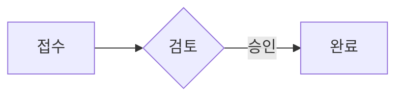
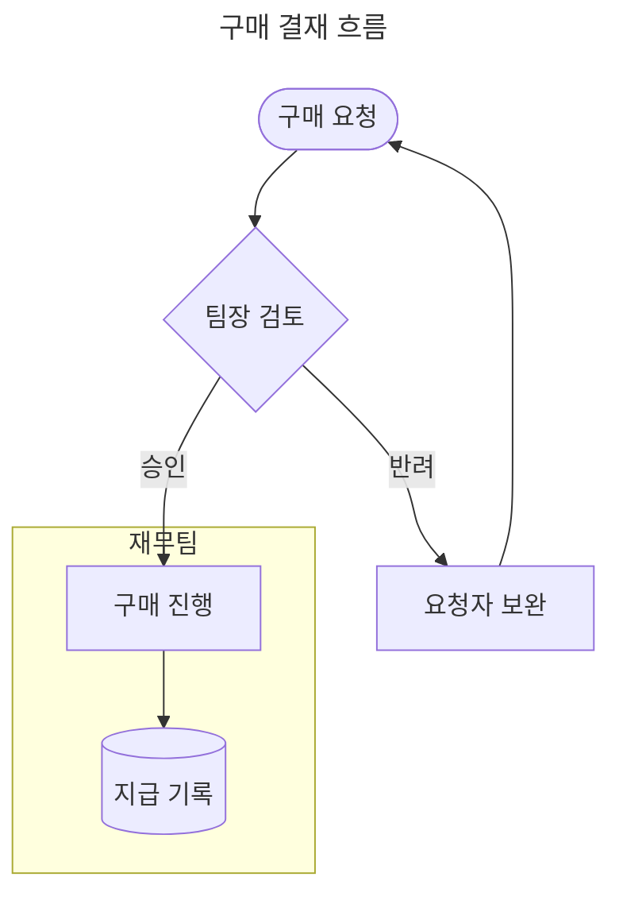

<!-- itda-hyve 0.17.2 · syntax_hash daec08f11fe4 · 주제 all -->
<!-- itda-hyve 마크다운 문법 · 주제 index · 자동 생성(docs/GUIDE-markdown.md) — 손으로 고치지 않는다. 장 번호("3장")는 이 주제 안의 번호다 -->

## 1. 빠른 시작

문서는 **보통의 마크다운**(CommonMark + GitHub 표·작업 목록·취소선·각주·알림)이다. 거기에 Pandoc 계열의 사실상 표준 몇 가지(frontmatter·정의 목록·속성 `{#id .class}`·표 캡션·`:::` 컨테이너)를 더했다.
새 기호를 만들지 않았으므로 GitHub·VS Code·Obsidian 에서 열어도 내용이 깨지지 않는다.

- **모양은 테마가 정한다.** 문서에는 뜻만 적는다 — 색·글꼴·여백을 적는 문법은 없다. `theme:` 으로 테마를 고른다.
- **쪽 나눔은 저절로 된다.** 문서 창이 A4 쪽으로 나눈다. 꼭 나눠야 할 곳에만 `<!-- pagebreak -->` 를 쓴다.
- **표가 차트가 된다.** GFM 표를 `:::chart` 로 감싼다. 수식은 `$…$`·`$$…$$`, 흐름도는 ```` ```mermaid ````.
- **raw HTML 은 그리지 않는다**(몇 가지 태그 말고). 경고로 알린다.
- **경고는 줄 번호와 함께 나온다.** 경고 0 이 목표다 — 코드마다 고치는 법은 9장.

완성된 최소 문서:

```markdown
---
title: 2026년 4분기 사업 계획
author: 홍길동
date: 2026-10-14
theme: report
toc: true
number-sections: true
---

:::lead
4분기에는 신규 고객 30곳을 목표로 한다.
:::

# 현황

3분기 매출은 **44.9억 원**으로 전 분기보다 8% 늘었다.

:::chart{type=bar unit="억 원"}
| 분기 | 2025 | 2026 |
|---|--:|--:|
| 1분기 | 31.0 | 38.2 |
| 2분기 | 35.4 | 41.5 |
| 3분기 | 39.1 | 44.9 |

: 분기별 매출
:::

# 계획

1. 신규 고객 30곳
2. 재계약률 90% 유지

> [!NOTE]
> 세부 일정은 붙임을 본다.
```

**주제별 문법**(Claude 는 `md_syntax(주제)` 또는 `itda-hyve md --syntax 주제` 로 같은 글을 받는다):

| 주제 | 내용 | 안내서 |
|---|---|---|
| `core` | frontmatter, 제목·번호, 쪽 나눔, 컨테이너, 알림, 그림·표 캡션, 목차, 각주·정의 목록, 링크·이미지·HTML, 목록 기호 사다리, 경고 코드, 지원하지 않는 것 | 이 안내서 2~10장 |
| `charts` | `:::chart` — 종류 9가지, 속성, 숫자 읽기, 상한, 경고 | [GUIDE-markdown-charts.md](GUIDE-markdown-charts.md) |
| `math` | `$…$`·`$$…$$`·```` ```math ```` — 달러 기호 규칙, 지원 범위, 상한 | [GUIDE-markdown-math.md](GUIDE-markdown-math.md) |
| `diagrams` | ```` ```mermaid ```` 흐름도 — 지원 문법, 그리지 않는 것, 상한 | [GUIDE-markdown-diagrams.md](GUIDE-markdown-diagrams.md) |
| `slides` | 슬라이드 나눔, `slides:`, 차례로 나타내기, 발표자 노트 | [GUIDE-markdown-slides.md](GUIDE-markdown-slides.md) |

문서 작업 순서(사람이든 Claude 든): 필요한 주제의 문법을 읽는다 → 쓴다 → 문서 창의 경고 단추(또는 `md_check`·`itda-hyve md --check`)로 경고를 본다 → 고친다.
경고를 숨기려고 데이터를 지우지 않는다(차트 상한을 넘으면 차트를 나누거나 `table=below` 로 표를 함께 싣는다).

<!-- itda-hyve 마크다운 문법 · 주제 core · 자동 생성(docs/GUIDE-markdown.md) — 손으로 고치지 않는다. 장 번호("3장")는 이 주제 안의 번호다 -->

## 2. frontmatter — 문서 정보

파일 맨 앞의 `---` 와 `---`(또는 `...`) 사이 YAML 블록이다. 키 이름은 Pandoc 을 따른다(kebab-case). 모두 선택이다.
값은 글자로만 쓰인다(HTML 로 해석하지 않는다). 닫는 줄이 없으면 frontmatter 가 아니다(첫 줄의 가로줄로 읽힌다).

| 키 | 값 | 기본 | 뜻 |
|---|---|---|---|
| `title` | 글자 | 없음 | 문서 제목(표지·머리글) |
| `subtitle` | 글자 | 없음 | 부제 |
| `author` | 글자 또는 글자 목록(`- name: …` 꼴도) | 없음 | 쓴 사람 |
| `date` | 글자 | 없음 | 날짜. 적은 글자 그대로 보인다 |
| `lang` | 글자 | 없음(한국어) | 비어 있거나 `ko` 로 시작하면(`ko-KR`) 알림 제목이 한국어, 그 밖은 영어 |
| `toc` | `true`·`false` | `false` | 목차를 넣는다(7장) |
| `toc-depth` | 1~6 | 3 | 목차에 넣는 제목 단계 |
| `number-sections` | `true`·`false` | `false` | 제목 번호 1. / 1.1 / 1.1.1 |
| `papersize` | `a4`·`a4-landscape` | `a4` | 종이 |
| `theme` | 테마 이름 또는 별칭 | `report` | 테마(3장) |
| `cover` | `true`·`false` | 테마가 정함 | 표지 쪽 |
| `doc-no` | 글자 | 없음 | 문서 번호(표지·머리글) |
| `version` | 글자(`"1.2"` 처럼 따옴표) | 없음 | 판 |
| `classification` | 글자 | 없음 | 보안 등급(표지·머리글. 예: 대외비) |
| `organization` | 글자 | 테마가 정함 | 조직 이름 |
| `list-style` | `gaejosik`·`gongmun`·`plain` 또는 `[gaejosik, gongmun]` | 테마가 정함 | 목록 기호 사다리(8장) |
| `slides` | `true` 또는 설정 매핑 | 없음 | 발표 자료 — 키는 [발표 안내서](GUIDE-markdown-slides.md) |

- 표에 없는 키도 버리지 않고 순서대로 테마에 넘긴다. 공문의 `수신`·`참조`·`시행일` 처럼 테마가 표지·머리글에 쓰는 값이다.
- 아는 키의 값 꼴이 틀리면 그 키만 무시하고 `frontmatter-value` 경고를 낸다. YAML 이 깨졌으면 블록 전체를 본문으로 그리고 `frontmatter-invalid` 경고를 낸다.
- `version: 1.10` 처럼 숫자로 읽히는 값도 이 앱은 적은 글자 그대로 쓴다. 다른 YAML 도구에서 숫자(`1.1`)로 바뀌지 않게 따옴표를 권한다.

## 3. 테마

`theme:` 에 이름이나 별칭을 적는다. 없으면 `report` 다. 모르는 이름이면 `report` 로 보이고 `unknown-theme` 경고가 난다.

| 이름 | 별칭 | 쓰임 |
|---|---|---|
| `report` | 보고서·default | 사업·업무 보고서. 표지, 제목 번호, 머리글에 조직·문서 제목 |
| `proposal` | 제안서 | 고객에게 보내는 제안서. 색 면 표지, 돋보이는 요약문·상자 |
| `official` | gongmun·공문·기안·기안문 | 기안문·공문. 흑백, 가운데 제목, 수신·참조 줄, 결재란. 목록 기호 사다리가 켜져 있다 |
| `minutes` | 회의록·minute·meeting | 회의록. 표지 없이 회의 정보 표, 결정 사항·할 일 |
| `manual` | 매뉴얼·절차서·업무매뉴얼·guide | 업무 매뉴얼·절차서. 개정 이력, 제n장, 절차 단계 |

회사 테마는 `~/.itda/hyve/themes/<이름>/` 에 두고 같은 방식으로 이름을 적는다([테마 안내서](GUIDE-document-themes.md)).

## 4. 제목 — id·속성·번호

- **id** 는 GitHub 과 같은 규칙으로 저절로 붙는다(소문자, 공백 → `-`, 한글은 그대로, 겹치면 `-1`·`-2`). `[현황으로](#현황)` 이 GitHub 에서처럼 동작한다.
- **속성**: `## 제목 {#custom-id .class}`. 속성을 하나라도 읽지 못하면 `{…}` 전체를 글자로 남기고 `bad-attribute` 경고를 낸다. 직접 적은 id 가 겹치면 `duplicate-id` 경고.
- **번호**: `number-sections: true` 면 렌더러가 번호를 넣는다. `{-}` 또는 `{.unnumbered}` 는 번호를 건너뛰고, `{.unlisted}` 는 목차에서만 뺀다(번호는 받는다).
- **기준 단계**: 번호와 `toc-depth` 는 문서에서 **가장 높은 제목 단계를 1로** 센다. frontmatter `title` 을 두고 `##` 부터 써도 번호는 `1` 부터다.

```markdown
# 개요

## 배경 {#bg}

## 참고 자료 {-}

## 내부 메모 {.unlisted}
```

## 5. 쪽 나눔

쪽은 문서 창이 저절로 나눈다(표 머리는 다음 쪽에 되풀이, 그림·알림·`box`·결재란은 통째로 옮긴다). 꼭 나눠야 할 곳에만 쓴다.

| 표기 | 구분 |
|---|---|
| `<!-- pagebreak -->` | **쓰는 표기** — 다른 뷰어에서 안 보인다 |
| `<div style="page-break-after: always"></div>` | 받아들임(Typora·Obsidian 관용) — 다른 뷰어에서는 인쇄 때 같은 동작 |
| `\newpage` (한 줄 단독) | 받아들임(Pandoc 관용) — 다른 뷰어에서 글자로 보인다 |

- 블록 자리(앞뒤 빈 줄)에서만 쪽 나눔이다. 문단 안의 주석·`\newpage` 는 아니다.
- `#` 앞에서 늘 쪽을 나누는 것은 문법이 아니라 테마 설정이다.
- 쪽 사이에서 쪼개지 않으려는 블록은 `:::keep` 으로 감싼다.

```markdown
첫 쪽의 끝.

<!-- pagebreak -->

# 둘째 쪽
```

## 6. 컨테이너 `:::`

표준에 없는 블록(가운데 정렬·다단·서명란·요약문)은 Pandoc 의 fenced div 하나로 쓴다.

- **여는 줄**: 콜론 3개 이상 + 이름(`:::이름` 또는 `::: 이름`) 그리고/또는 속성 `{…}`. 이름은 글자·숫자·`-`·`_`(한글 가능). 앞에 빈 줄이 있어야 열린다(문단 중간에서는 안 열린다).
- **닫는 줄**: 콜론만 있는 줄. 가장 안쪽 컨테이너를 닫는다. 바깥 것에는 콜론을 더 많이 쓴다(`::::columns`). 닫지 않으면 문서 끝에서 닫히고 `unclosed-container` 경고가 난다.
- **속성**: `#id`·`.class`·`key=value`(값에 공백이 있으면 따옴표). `key=value` 는 `data-key` 로만 나간다. 예외는 `column` 의 `width` 하나(길이 꼴: 숫자 + `% mm cm in pt pc px em rem ch`, 단위 없으면 px).

| 이름 | 뜻 |
|---|---|
| `center` | 가운데 정렬 |
| `right` | 오른쪽 정렬(날짜·발신 명의) |
| `columns` | 다단 — 안에 `column` 들 |
| `column` | 단 하나. `{width=40%}` 로 너비 |
| `box` | 테두리 상자 |
| `lead` | 요약문(문서 첫머리) |
| `keep` | 쪽 사이에서 쪼개지 않음 |
| `signature` | 서명란 |
| `approval` | 결재란 — 안에 표를 쓴다 |
| `chart` | 차트 — [차트 안내서](GUIDE-markdown-charts.md) |
| `incremental` | 발표에서 목록을 하나씩 — [발표 안내서](GUIDE-markdown-slides.md) |
| `nonincremental` | 발표에서 하나씩 나타내기를 끔 |
| `notes` | 발표자 노트(문서·슬라이드에 안 보임) |

모르는 이름도 `<div class="이름">` 으로 나간다 — 회사 테마가 자기 어휘로 쓴다. 내장 테마의 자기 어휘: `minutes` 의 `decisions`(결정 사항)·`actions`(할 일 표), `manual` 의 `steps`(절차 단계)·`result`(단계의 결과).
강조 상자는 `note`·`warning` 컨테이너가 아니라 알림(`> [!NOTE]`)으로 쓴다.

```markdown
:::right
2026년 10월 14일
잇다워크 대표 홍길동
:::

::::columns
:::column{width=40%}
왼쪽 단
:::
:::column
오른쪽 단
:::
::::

:::approval
| 담당 | 팀장 | 본부장 |
|:-:|:-:|:-:|
| 홍길동 | | |
:::
```

## 7. 알림·그림·표 캡션·목차·각주·정의 목록

**알림**(GFM): `> [!NOTE]`·`[!TIP]`·`[!IMPORTANT]`·`[!WARNING]`·`[!CAUTION]` 다섯 가지. 표시가 첫 줄에 혼자 있어야 한다. 제목 글자는 `lang` 을 따른다(참고·팁·중요·주의·경고).

```markdown
> [!WARNING]
> 결재 전에는 외부로 보내지 않는다.
```

**그림**: 이미지 하나만 있는 문단은 그림(`figure`)이 된다. 캡션은 **title**(따옴표 부분)이다 — 대체 글(alt)은 캡션이 아니다. 크기는 `{width=50%}` 만 받는다(6장의 길이 꼴).

```markdown
{width=70%}
```

**표 캡션**: 표 **바로 다음** 문단을 `Table:` 또는 `:` 로 시작한다. 표 앞의 캡션은 받지 않는다(정의 목록과 겹친다).

```markdown
| 항목 | 금액 |
|---|--:|
| 인건비 | 1,200 |

Table: 예산(단위: 만 원)
```

**목차**: `toc: true` 면 표지(또는 제목) 다음에 넣는다. 자리를 정하려면 `[TOC]` 한 줄 문단을 쓴다(`toc` 값과 무관하게 그 자리에 그린다).

**각주**: `[^1]` 과 `[^1]: 내용`. 문서 끝에 모인다(쪽 아래 각주는 없다).

**정의 목록**: 용어 다음 줄 `: 설명`. 공문의 수신·제목 줄에 쓴다. 설명이 `1.` 로 시작하면 번호 목록이 되므로 `1\.` 로 쓴다.

```markdown
수신
: 각 부서장

붙임
: 1\. 세부 계획 1부. 끝.

본문에 각주를 단다.[^근거]

[^근거]: 2026년 3분기 결산 자료.
```

## 8. 글·목록·링크·이미지·HTML

- **강조**: `**굵게**`·`*기울임*`·`~~취소선~~`. 한국어 경계를 따른다 — `**"인용"**은`·`**결론:**입니다` 도 굵게 된다(CommonMark CJK-friendly). GitHub 등 다른 뷰어에서는 글자로 보일 수 있다.
- **줄바꿈**: 문단 안 줄바꿈은 공백이 된다. 줄을 바꾸려면 줄 끝에 `\` 또는 공백 둘, 표 칸 안에서는 `<br>`.
- **목록**: `-`·`1.`·작업 목록 `- [ ]`·`- [x]`. 번호는 첫 항목의 숫자부터.
- **목록 기호 사다리**: 개조식(`□ → ○ → - → ·`)·공문(`1. → 가. → 1) → 가) → (1) → (가) → ① → ㉮`) 기호는 **글자로 적지 않는다**. 보통의 `-`·`1.` 목록을 들여 써서 단계를 나누고 frontmatter `list-style: gaejosik`(비순서 목록)·`gongmun`(순서 목록)·`[gaejosik, gongmun]`(둘 다)·`plain`(끔)으로 켠다. `official` 테마는 둘 다 켜져 있다. 글자로 적으면 `list-marker` 경고가 난다.

```markdown
---
list-style: [gaejosik, gongmun]
---

- 추진 배경
  - 고객 요청 증가
    - 월 20건 → 45건

1. 추진 계획
   1. 1단계: 설계
   2. 2단계: 구축
```

- **링크**: 상대 주소·`#조각`·`http`·`https`·`mailto`·`tel` 만 링크가 된다. 그 밖(`javascript:`·`file:` 등)은 글자만 남고 `unsafe-url` 경고. 주소 글자(`https://…`·`www.…`)는 저절로 링크가 된다(`ftp://…` 글자는 막힌 주소라 `unsafe-url` 경고).
- **이미지**: 상대 경로(문서 폴더 아래 실제 파일만)·`data:image/…`·원격(`http(s)`). 원격 이미지는 기본으로 불러오지 않고 `remote-image` 경고를 낸다 — 메일로 온 문서의 추적 그림을 막는다. 문서 창에서 문서마다 켤 수 있다.
- **raw HTML 은 그리지 않는다.** 속성 없는 `<br>`·`<sub>`·`<sup>`·`<kbd>`·`<mark>`·`<u>`·`<ins>`·`<small>` 과 5장의 쪽 나눔만 예외이고, 짝이 맞아야 남는다. 나머지는 버리고 `raw-html` 경고. HTML 주석은 조용히 버린다.
- **코드 블록**: ```` ```언어 ```` — 구문 강조는 아직 없다. ```` ```mermaid ```` 는 그림, ```` ```math ```` 는 수식이다.
- **수식**: `$E = mc^2$`(글 안)·`$$…$$`(블록). `$30 와 $40` 같은 금액은 수식이 아니다. 수식 안의 퍼센트는 `\%` 로 쓴다(`%` 부터 줄 끝은 TeX 주석) — [수식 안내서](GUIDE-markdown-math.md).
- **흐름도**: ```` ```mermaid ```` 의 `flowchart`·`graph` — [그림 안내서](GUIDE-markdown-diagrams.md).

````markdown
값은 $\frac{a}{b}$ 이다. 금액 $30 와 $40 은 글자다.

$$
\sum_{i=1}^{n} x_i
$$


````

### 한국어 업무 문서의 함정

표준대로 읽으면 흔한 표기가 다른 뜻이 되는 곳이다. 렌더는 다른 뷰어와 같게 두고 경고만 낸다.

| 코드 | 이렇게 쓰면 | 이렇게 된다 | 고치는 표기 |
|---|---|---|---|
| `tilde-range` | `3~5명, 10~20명` | `~5명, 10~` 이 취소선 | `3\~5명` |
| `date-list` | 줄 머리 `2026. 10. 14.` | 번호 목록 안 번호 목록 | `2026\. 10. 14.` |
| `list-marker` | `- ○ 내용`·`1. 가. 내용` | 기호가 글자로 겹침 | 기호를 빼고 `list-style`(위) |

틀린 예 — `~5명, 10~` 이 취소선이 되고 `tilde-range` 경고가 난다:

```markdown
참석 3~5명, 예산 10~20만 원
```

고친 예:

```markdown
참석 3\~5명, 예산 10\~20만 원

2026\. 10. 14.(수) 교통정책과
```

## 9. 경고 코드

경고는 원문 줄 번호와 함께 문서 창의 경고 단추에 모인다(`md_check`·`itda-hyve md --check` 도 같은 목록). 경고가 나도 문서는 그려진다 — 버리거나 글자로 둔 곳을 알린다.

| 코드 | 뜻 | 고치는 법 |
|---|---|---|
| `raw-html` | 그리지 않은 HTML | 마크다운으로 바꾼다(8장 예외 태그 말고는 그려지지 않는다) |
| `frontmatter-invalid` | YAML 이 깨져 frontmatter 를 본문으로 그림 | 콜론 뒤 공백, 따옴표 짝, 들여쓰기를 고친다 |
| `frontmatter-value` | 아는 키의 값 꼴이 틀려 무시함 | 2장 표의 값 꼴로 |
| `unsafe-url` | 막은 링크·이미지 주소 | `http(s)`·`mailto`·`tel`·상대 주소로 |
| `remote-image` | 불러오지 않은 원격 이미지 | 그림 파일을 문서 폴더에 두고 상대 경로로(또는 문서 창에서 원격 그림 켜기) |
| `bad-attribute` | 알아보지 못한 `{…}` 속성 | `{#id .class key=value}` 꼴로, 길이는 6장의 꼴로 |
| `unclosed-container` | 문서 끝에서 닫힌 `:::` | 닫는 `:::` 줄을 넣는다 |
| `duplicate-id` | 직접 적은 id 가 겹침 | id 를 하나씩 다르게 |
| `too-complex` | 강조·링크 표시가 너무 많거나 블록 중첩이 64겹을 넘어 글자로 둠 | 문단을 나누고 중첩을 줄인다 |
| `chart` | 차트를 그리지 못했거나 일부 값을 버림 | 메시지대로 — [차트 안내서](GUIDE-markdown-charts.md) 10장 |
| `math` | 그리지 않은 수식(원문 그대로) | 메시지의 명령·문법을 고친다 — [수식 안내서](GUIDE-markdown-math.md) |
| `diagram` | 그리지 않은 mermaid 그림, 또는 무시한 줄(`style`·`click` …) | [그림 안내서](GUIDE-markdown-diagrams.md) 3장 |
| `tilde-range` | 범위로 보이는 `~` 가 취소선이 됨 | `\~` |
| `date-list` | 줄 머리 날짜가 번호 목록이 됨 | `2026\.` |
| `list-marker` | 목록 항목에 기호·항목 번호를 글자로 적음 | 기호를 빼고 `list-style` |
| `unknown-theme` | 모르는(또는 쓸 수 없는) 테마 — `report` 등으로 보임 | 3장의 이름으로 |

틀린 예 — 이렇게 쓰지 않는다. 글자만 남고 `raw-html`·`unsafe-url` 경고가 난다:

```markdown
<span style="color:red">빨간 글</span>

[열기](javascript:alert(1))
```

## 10. 지원하지 않는 것

넣지 않았거나 아직 없는 것이다. 쓰면 글자로 보이거나(경고 없이) 경고가 난다.

- `==강조==`·`++삽입++`·이모지 단축어(`:smile:`)·위키 링크(`[[문서]]`)·변수 치환(`{{…}}`)
- 파일 포함 — CSV 도 문서가 가리키지 않는다. 편집기의 **CSV 표** 넣기 도구가 표로 가져온다
- 색·글꼴·크기 지정(`style`·`<font>`) — 테마가 정한다
- 표 칸 병합, 쪽 아래 각주, 식 번호(`\tag`·`\label`), 구문 강조
- 인라인 디렉티브 `:이름[…]`·한 줄 `::이름`
- mermaid 의 흐름도 말고 다른 그림 종류(시퀀스·간트 등)

<!-- itda-hyve 마크다운 문법 · 주제 charts · 자동 생성(docs/GUIDE-markdown-charts.md) — 손으로 고치지 않는다. 장 번호("3장")는 이 주제 안의 번호다 -->

차트의 데이터는 **표 그대로**다. `:::chart` 로 감싼 표를 문서 창이 SVG 로 그리고, 다른 뷰어에서는 표로 보여 숫자를 잃지 않는다.

## 1. 한눈에

```markdown
:::chart{type=bar unit="억 원"}

| 분기 | 2025 | 2026 |
|:--|--:|--:|
| 1분기 | 31.0 | 38.2 |
| 2분기 | 35.4 | 41.5 |
| 3분기 | 39.1 | 44.9 |

: 분기별 매출

:::
```

넣기 도구의 **차트** 를 누르면 이와 비슷한 견본 표가 들어간다. 엑셀·시스템의 CSV 는 편집기의 **CSV 표** 넣기 도구로 가져온다(문법이 아니라 편집기 기능 — 차트 안내서 15장).

## 2. 문법

**컨테이너**: `:::chart{속성}` 로 열고 `:::` 로 닫는다. 안에 GFM 표 하나를 둔다. 이름은 `chart` 여야 한다(`{.chart}` 클래스만으로는 차트가 아니다).

| 속성 | 뜻 | 대표 표기 | 함께 받는 표기 |
|---|---|---|---|
| `type` | 차트 종류(3장). 없으면 `bar` | `type=line` | 대소문자 무시(`type=Line`) |
| `unit` | 값 단위. 위쪽에 "단위: …" 로 적고(원·도넛은 아래 목록의 값 뒤에), 칸의 같은 꼬리를 뗀다(4장). `scatter`·`bubble` 에는 없다(단위는 열 머리글에, 3.11) | `unit="억 원"` | 공백이 없으면 따옴표 없이 `unit=명` |
| `labels` | 값 글자(6장). 기본은 켬 | `labels=off` | 끄기: `false`·`no`·`none`·`0`(대소문자 무시). 그 밖의 값은 모두 켬 |
| `table` | 그림 아래에 표도 보인다(11장). 기본은 표를 숨김 | `table=below` | `table=on`. 그 밖의 값은 숨김(경고 없음) |
| `ref` | 기준선(목표선)의 값(3.8). `pie`·`donut`·`scatter`·`bubble` 에는 없다 | `ref=40` | 4장의 숫자 꼴(`ref="1,000"`·`ref="40억 원"`·`ref="10%"`) |
| `ref-label` | 기준선 라벨. `ref` 와 함께만 | `ref-label="목표"` | |
| `line` | 그 이름의 계열을 선으로, 나머지는 막대로(3.9). `bar` 에만 | `line="계획"` | 공백이 없으면 따옴표 없이 `line=계획`. 이름의 공백은 하나로 줄여 맞춘다 |
| `axis2` | 그 이름의 계열을 오른쪽 축(보조 축)으로(3.10). `bar`·`line` 에만 | `axis2="이익률"` | `line` 과 같은 이름 맞추기 |
| `unit2` | 오른쪽 축의 단위. `axis2` 와 함께만 | `unit2="%"` | `unit` 과 같은 꼴(`unit2=건`) |
| `#id` | 그림(`<figure>`)의 id — 링크·테마 CSS 에서 고른다 | `#q3-sales` | |
| `.class` | 그림의 클래스 — 회사 테마가 모양을 줄 수 있다 | `.wide` | |

속성은 공백으로 띄워 적는다: `:::chart{#q3-sales .wide type=bar unit="억 원" table=below}`. 모양(색·글꼴·크기)을 정하는 속성은 없다 —
색은 테마가 정한다(7장). 그 밖의 키를 쓰면 경고하고 무시한다(10장). `ref`·`ref-label`·`line`·`axis2`·`unit2` 는 0.17.0 판부터다 —
0.16.0 까지의 판은 "쓰지 않음" 경고를 내고 기준선 없이, `line` 의 계열도 막대로, `axis2` 의 계열도 왼쪽 축으로 그린다.

**표 규칙**

- **첫 열은 항목**(가로축 이름, 원의 조각 이름)이다. 첫 열의 머리 칸은 쓰지 않는다(무엇을 적어도 된다).
- **둘째 열부터가 계열**이고, 머리 행의 글자가 계열 이름(범례)이다. 열 하나가 막대 한 벌·선 하나다.
- **캡션**: 표 바로 다음 문단을 `: ` 또는 `Table: ` 로 시작하면 차트 캡션이 되고 그림 번호("그림 1")를 받는다. 없으면 번호 없는 그림이다.
- **빈 줄**: 컨테이너 여는 줄과 표 사이, 캡션과 닫는 `:::` 사이에 빈 줄을 둔다. 문서 창은 빈 줄이 없어도 같게 그리지만,
  빈 줄이 없으면 다른 뷰어에서 캡션과 `:::` 가 한 문단으로 붙고, 표가 문단에 이어 붙으면 표로 읽지 않는 뷰어도 있다(9장).
- 표 말고 컨테이너 안에 든 것(설명 문단 등)은 그림 뒤에 그대로 나온다.
- **산점도·버블은 표 꼴이 다르다**: 첫 열은 점 라벨, 둘째·셋째 열이 x·y 값, 버블은 넷째 열이 크기다(3.11·3.12).

## 3. 종류 9가지

| 종류 | 그림 | 알맞은 데이터 | 판 |
|---|---|---|---|
| `bar` | 세로 막대(기본) | 항목 몇 개를 계열 몇 개로 견주기 | 0.11.0 |
| `hbar` | 가로 막대 | 항목 이름이 길 때, 순위 | 0.11.0 |
| `stacked` | 쌓은 막대 | 합계와 그 구성 | 0.11.0 |
| `line` | 꺾은선 | 차례가 있는 항목(월·분기)의 추이 | 0.11.0 |
| `area` | 면 | 추이와 크기를 함께 | 0.11.0 |
| `pie` | 원 | 한 계열의 구성 비율 | 0.11.0 |
| `donut` | 도넛 | 원과 같고 가운데에 합계 | 0.11.0 |
| `scatter` | 산점도 | 두 수치(x·y)의 관계 — 행마다 점 하나 | 0.17.0 |
| `bubble` | 버블 | 산점도 + 셋째 수치(원의 넓이) | 0.17.0 |

**판**은 그 종류를 처음 그린 itda-hyve 판이다. 문서를 받는 사람의 판이 그보다 옛것이면 그 종류를 모른다.
**모르는 `type` 은 차트를 그리지 않고 표를 그대로 보이며 경고한다**(0.17.0 판부터 — 새 판에 생길 종류의 열을 옛 판이 막대로 잘못 그리지 않게).
0.16.0 까지의 판은 모르는 `type` 을 경고와 함께 `bar` 로 그렸다.

### 3.1 `bar` — 세로 막대

막대는 늘 0 에서 자란다. 음수는 0 기준선 아래로 자라고 값 글자는 막대 아래에 붙는다 — 그 글자 자리가 그림 안에 나지 않으면 눈금을 한 칸 더 내린다(항목 이름과 겹치지 않게).

```markdown
:::chart{type=bar unit="억 원"}

| 월 | 순현금흐름 |
|:--|--:|
| 1월 | 3.2 |
| 2월 | -1.4 |
| 3월 | 2.8 |
| 4월 | 4.1 |
| 5월 | -0.6 |
| 6월 | 5.3 |

: 월별 순현금흐름

:::
```

### 3.2 `hbar` — 가로 막대

항목 이름이 길 때 알맞다. 이름은 왼쪽(차트 너비의 3분의 1 안쪽)에 오른쪽 맞춤으로 적고, 넘치면 `…` 로 줄인다(계열이 둘 이상이라 줄이 높으면 두 줄).
이 예는 `table=below` 로 표도 함께 보인다.

```markdown
:::chart{type=hbar unit="%" table=below}

| 지역 | 전년 대비 증감 |
|:--|--:|
| 서울·수도권 기업 고객 | 18.4% |
| 부산·울산·경남 | 7.2% |
| 대구·경북 | -3.6% |
| 광주·전남·전북 공공 부문 | -11.0% |
| 대전·세종·충청 | 4.9% |

: 지역별 매출 증감

:::
```

### 3.3 `stacked` — 쌓은 막대

계열을 한 막대에 쌓는다. 양수는 위로, 음수는 아래로 따로 쌓고, 막대 위에 양수 합계를 적는다.

```markdown
:::chart{type=stacked unit="억 원"}

| 분기 | 기업 | 공공 | 파트너 |
|:--|--:|--:|--:|
| 1분기 | 24.1 | 10.2 | 3.9 |
| 2분기 | 26.8 | 9.6 | 5.1 |
| 3분기 | 31.5 | 6.9 | 6.5 |

: 고객군별 매출

:::
```

### 3.4 `line` — 꺾은선

빈 값에서 선이 끊긴다. 막대와 달리 값이 모두 0 에서 멀면(가장 작은 값이 가장 큰 값의 절반보다 크면 — 음수 쪽도 마찬가지) 0 부터 그리지 않는다.
다만 읽은 값이 모두 같으면(한 값뿐이거나 `100`·`100` 처럼) 0 부터 그린다.
항목은 **같은 간격**으로 놓인다 — 날짜를 적어도 날짜 간격대로 놓지 않는다(12장).
이 예는 `unit` 이 없지만 값이 모두 `%` 라 단위가 `%` 가 된다(4장).

```markdown
:::chart{type=line}

| 월 | 영업이익률 |
|:--|--:|
| 1월 | 8.2% |
| 2월 | 4.1% |
| 3월 | -2.5% |
| 4월 | 6.8% |
| 5월 | 9.4% |
| 6월 | 11.0% |
| 7월 | 10.2% |
| 8월 | 12.6% |
| 9월 | 13.1% |

: 월별 영업이익률

:::
```

### 3.5 `area` — 면

선 아래를 옅게 칠한다(옅기는 테마 토큰 `--chart-area-opacity`). 면은 0 에서 시작한다.

```markdown
:::chart{type=area unit="명"}

| 주 | 방문 고객 | 체험 신청 |
|:--|--:|--:|
| 1주 | 1,240 | 310 |
| 2주 | 1,385 | 352 |
| 3주 | 1,302 | 340 |
| 4주 | 1,630 | 418 |
| 5주 | 1,812 | 470 |
| 6주 | 1,755 | 455 |
| 7주 | 2,034 | 512 |
| 8주 | 2,210 | 566 |

: 주별 방문 고객과 체험 신청

:::
```

### 3.6 `pie` — 원

**첫 계열만** 쓴다(셋째 열부터는 경고 없이 쓰지 않는다 — 다만 계열 열이 8개를 넘으면 5장의 계열 상한 경고는 난다). 조각은 12시에서 시계 방향으로 표의 차례대로 놓인다. 아래 목록에 항목·값·비율을 적는다.

```markdown
:::chart{type=pie}

| 고객군 | 3분기 매출 |
|:--|--:|
| 기업 | 31.5 |
| 공공 | 6.9 |
| 파트너 | 6.5 |

: 3분기 매출 비중

:::
```

### 3.7 `donut` — 도넛

원과 같고, 가운데에 합계와 단위를 적는다.

```markdown
:::chart{type=donut unit="건"}

| 채널 | 신규 계약 |
|:--|--:|
| 직접 영업 | 12 |
| 파트너 | 6 |
| 온라인 문의 | 3 |

: 3분기 신규 계약 경로

:::
```

원·도넛은 좁은 그림이라 다단(`::::columns`)의 한 단에 넣어도 글자가 읽힌다. 넓은 자리에서도 92mm 보다 크게 늘지 않는다.

### 3.8 기준선 — `ref`

`bar`·`stacked`·`line`·`area` 에는 가로 점선, `hbar` 에는 세로 점선을 값 `ref` 자리에 하나 긋는다(0.17.0 판부터). `pie`·`donut` 에는 긋지 않는다(경고).

- **축 범위에 든다**: 값보다 크거나 작은 기준선도 보이도록 눈금을 넓힌다. 꺾은선은 기준선을 넣은 범위에 3.4 의 "0 부터" 규칙을 적용한다.
  `stacked` 는 쌓은 합계와 같은 축이다.
- **라벨**: `ref-label` 과 값을 함께 적는다(`목표 40.0` — 라벨이 없으면 값만). 값의 소수 자리는 표의 값 글자와 같고, `ref` 에 더 길게 적었으면 그 자리다.
  세로형은 그림 영역 **오른쪽 밖**(그만큼 그림이 좁아진다), `hbar` 는 막대 영역 **위**에 둔다 — 막대·점·값 글자와 겹치지 않는다
  (`line`·`area` 의 끝 값 글자가 오른쪽으로 삐져나오면 그림 영역 안으로 당긴다). 긴 라벨은 `…` 로 줄인다.
- 점선은 글자색이고 아래에 종이색 테두리를 깔아 같은 색 막대(공문의 검정 막대) 위에서도 보인다. 기준선이 있으면 값 글자를 점선 **위에** 종이색 테두리를 둘러 그린다 —
  점선이 값 글자를 가로지르지 않는다.
- 마우스를 올리면 "목표: 40.0 억 원" 이 보인다(`<title>`, 라벨이 없으면 "기준선"). 점선은 움직이지 않는다.
- 기준선은 **하나**다. 여러 개(`ref="목표=40,상한=1,000"` 꼴)는 받지 않는다 — 쉼표가 천 단위와 겹친다.
- 다른 뷰어에서는 기준선이 보이지 않는다 — 여는 줄의 글자로만 남는다(9장). 값이 중요하면 캡션에도 적는다.

```markdown
:::chart{type=bar unit="억 원" ref=40 ref-label="목표"}

| 분기 | 매출 |
|:--|--:|
| 1분기 | 31.0 |
| 2분기 | 35.4 |
| 3분기 | 44.9 |
| 4분기 | 52.0 |

: 분기별 매출과 목표(40억 원)

:::
```

### 3.9 막대 + 선 — `line`

`bar` 에 `line="계열 이름"` 을 주면 그 계열을 **꺾은선**으로, 나머지 계열을 묶은 막대로 그린다(0.17.0 판부터). 실적은 막대, 계획·평균은 선으로 겹쳐 볼 때 쓴다.

- **이름으로 가리킨다**: 머리 행의 계열 이름과 같아야 한다(열 차례가 바뀌어도 같은 계열이다). 앞뒤 공백을 떼고 가운데 공백을 하나로 줄여 맞추고,
  대소문자는 가린다. 숫자 이름(`line=2026`)도 이름이다 — 열 번호로 읽지 않는다.
- **선은 하나**다. `bar` 말고 다른 종류(`stacked`·`hbar`·`line`·`area`·`pie`·`donut`)와 함께 쓰거나, 이름이 비었거나·없거나·같은 이름의 계열이 둘 이상이거나,
  그 계열이 상한(8번째 계열) 밖이거나, 그 계열을 빼면 막대가 남지 않으면 **차트 없이 표를 그대로** 보이고 경고한다(10장) — 엉뚱한 계열을 선으로 그리지 않게.
- **축은 하나**다: 선 계열도 막대와 같은 값 축이고, 막대가 있으므로 축은 늘 0 을 포함한다. 단위가 다른 계열(매출 억 원과 이익률 %)을 함께 그리면
  작은 쪽이 바닥에 깔린다 — 단위가 다르면 선 계열을 오른쪽 축(`axis2`, 3.10)으로 그린다.
- **선과 점**은 막대 위에, 그 항목의 막대 묶음 가운데에 놓인다. 선 아래에 종이색 테두리를 깔아 같은 색 막대(공문의 검정) 위에서도 보인다. 빈 값에서 선이 끊긴다.
- **범례**: 막대 계열은 사각형, 선 계열은 선과 점으로 그려 색 말고 모양으로도 가린다. 색은 다른 차트처럼 열 차례다 — 다만 공문은 선 계열을 글자색으로 그린다(7장).
- **값 글자**: 막대가 먼저다(6장의 `bar` 규칙). 선의 값은 막대의 값 글자와 겹치지도 붙지도(8 안쪽) 않고, 선의 값끼리 겹치지 않으며,
  그림 안(항목 이름 줄 위, 좌우 끝 안)에 들 때만 적는다 — 붙어 있으면 두 값이 한 쌍으로 읽힌다.
  모든 점(항목 12개 이하) → 마지막 점 → 적지 않음 차례로 그런 첫 단계를 쓴다(긴 숫자 12개는 서로 겹치므로 마지막 점이나 없음이 된다). 적지 않은 값도 점에 마우스를 올리면 보인다(`<title>`). 값 글자는 모두 선 위에 종이색 테두리를 둘러 그린다 — 선이 글자를 가로지르지 않는다.
- 기준선(3.8)과 함께 쓸 수 있다. 다른 뷰어에서는 선 계열도 표의 한 열로 보인다.

```markdown
:::chart{type=bar unit="억 원" line="2026 계획"}

| 분기 | 2025 | 2026 | 2026 계획 |
|:--|--:|--:|--:|
| 1분기 | 31.0 | 38.2 | 36.0 |
| 2분기 | 35.4 | 41.5 | 40.0 |
| 3분기 | 39.1 | 44.9 | 44.0 |
| 4분기 | 42.0 | 47.3 | 48.0 |

: 분기별 매출과 2026 계획

:::
```

### 3.10 보조 축 — `axis2`·`unit2`

`axis2="계열 이름"` 을 주면 그 계열을 **오른쪽 축**(보조 축)의 눈금으로 그린다(0.17.0 판부터). 매출(억 원)과 이익률(%)처럼 단위나 크기가 다른 두 가지를 한 그림에 둘 때 쓴다.

- **종류**: `bar` 와 `line` 에만. `bar` 에서는 오른쪽 축 계열을 **선**으로 그린다(3.9 의 막대 + 선과 같은 모양 — `line` 을 따로 적지 않아도 된다).
  막대를 두 눈금에 나눠 그리면 다른 눈금의 막대 높이를 견주게 되므로 오른쪽 축에는 막대를 두지 않는다. `line` 을 함께 적으면 같은 계열이어야 한다(선은 하나).
  `line` 에서는 그 계열만 오른쪽 눈금이고 나머지 선은 왼쪽 눈금이다. 그 밖의 종류(`stacked`·`hbar`·`area`·`pie`·`donut`)에는 **차트 없이 표를 그대로** 보이고 경고한다.
- **이름으로 가리킨다**: `line` 과 같다(3.9) — 공백을 하나로 줄여 머리 행의 계열 이름 하나와 같아야 하고, 숫자 이름을 열 번호로 읽지 않는다. 빈 이름·없는 이름·같은 이름 여럿·첫 열·
  8번째 밖, 그 계열을 빼면 왼쪽 축에 계열이 남지 않으면 표 그대로다.
- **단위·소수 자리·`%` 는 축마다**: `unit` 은 왼쪽 축, `unit2` 는 오른쪽 축의 단위다. 칸의 단위 꼬리도 그 축의 단위로 뗀다. `unit2` 가 없고 오른쪽 축 계열의 값이 모두 `%` 면
  오른쪽 축이 `%` 다(4장의 규칙을 축마다). 값 글자의 소수 자리도 축마다 그 축의 계열에 적힌 가장 긴 자리다. 마우스를 올리면 보이는 값(`<title>`)도 그 축의 단위로 적는다.
- **눈금**: 오른쪽 눈금은 그림 영역 오른쪽 밖에 적고(그만큼 그림이 좁아진다), 격자선은 왼쪽 축과 함께 쓴다 — 오른쪽 눈금 글자가 왼쪽 격자선 높이에 놓인다.
  막대가 있는 왼쪽 축은 0 을 포함하고, 오른쪽 축(선)은 3.4 의 선 규칙(0 에 가까우면 0 부터)이다. 두 축이 모두 0 을 지나면 **0 을 같은 격자선**에 맞춘다 —
  다만 그러면 선이 그림의 절반도 못 쓰게 될 때(막대의 0 이 맨 아래인데 선이 음수로 내려가는 때 등)는 맞추지 않는다.
- **표시**: 범례에서 오른쪽 축 계열 이름 뒤에 **"(오른쪽 축)"** 을 붙인다 — 색만으로 어느 축인지 가리지 않게. 위쪽 단위 줄은 "단위: 억 원 · 오른쪽 축 단위: 건" 꼴이다(`%` 는 눈금 글자에 붙으므로 적지 않는다).
  선의 값 글자는 그림 영역 안으로 당겨 오른쪽 눈금과 겹치지 않는다.
- **기준선과 함께 쓰지 않는다**: 기준선 라벨의 자리(그림 오른쪽 밖)를 오른쪽 눈금이 쓰고, 어느 축의 값인지도 헷갈린다 — `ref` 를 적으면 경고하고 기준선 없이 그린다.
- `unit2` 만 있고 `axis2` 가 없으면 경고하고 무시한다. 오른쪽 축 계열에 읽을 수 있는 숫자가 하나도 없으면 경고하고 오른쪽 축 없이 그린다.
- 다른 뷰어에서는 오른쪽 축 계열도 표의 한 열로 보인다. 단위가 열마다 다르면 머리 행에 단위를 적어 두면(`영업이익률(%)`) 표로도 읽힌다.

```markdown
:::chart{type=bar unit="억 원" axis2="영업이익률"}

| 분기 | 매출 | 영업이익률 |
|:--|--:|--:|
| 1분기 | 31.0 | 8.2% |
| 2분기 | 35.4 | 9.4% |
| 3분기 | 44.9 | 11.0% |
| 4분기 | 52.0 | 12.6% |

: 분기별 매출과 영업이익률

:::
```

### 3.11 `scatter` — 산점도

두 수치의 관계를 본다(0.17.0 판부터). 표 꼴이 다른 종류와 다르다: **첫 열은 점 라벨**, **둘째 열이 x**(가로), **셋째 열이 y**(세로)다. 행 하나가 점 하나다.

- **축은 둘 다 연속**이다: `line` 의 항목처럼 같은 간격이 아니라 값의 크기대로 놓인다(x 가 10·20·40 이면 간격이 1:2). 눈금은 축마다 5장의 보기 좋은 눈금이고,
  0 포함은 3.4 의 선 규칙이다(0 에 가까우면 0 부터, 0 에서 멀면 값 근처만). 0 을 지나면 0 에 짙은 기준선을 가로·세로로 긋는다.
- **축 제목은 열 머리글**이다: y 는 왼쪽 위, x 는 아래 가운데. 단위는 머리글에 적는다(`매출(억 원)`) — `unit` 은 쓰지 않는다(축이 둘이라 단위 하나로 정해지지 않는다. 적으면 경고하고 무시).
  `%` 는 열마다 4장의 규칙이다(그 열의 값이 모두 `%` 면 그 축 눈금에 `%`). 칸의 단위 꼬리(`38억 원`)는 떼지 않으므로 숫자만 적는다.
- **빈 값**: x·y 중 하나라도 빈 행은 점이 없다(경고 없음). 읽지 못한 칸은 경고하고 빈 값으로 둔다.
- **점 라벨**: 점의 오른쪽 → 왼쪽 → 위 → 아래 중 그림 안이고 다른 라벨·점과 겹치지 않는 첫 자리에 적고, 그런 자리가 없으면 적지 않는다(점이 많으면 일부만 적힌다).
  긴 라벨은 `…` 로 줄인다. `labels=off` 면 적지 않는다. 마우스를 올리면 "본점 · 매출(억 원): 120 · 영업이익률: 14.2%" 가 보인다(`<title>`).
- 같은 좌표의 점은 겹쳐 그린다(라벨은 서로 다른 자리에). 점은 선으로 잇지 않고, 점 집합은 하나(한 색)다.
- 셋째 열 뒤의 열은 쓰지 않는다(경고). `line`·`axis2` 는 받지 않고(표 그대로), `ref` 는 긋지 않는다(경고 — 축이 둘이라 어느 축의 값인지 정해지지 않는다).

```markdown
:::chart{type=scatter}

| 지점 | 매출(억 원) | 영업이익률 |
|:--|--:|--:|
| 본점 | 120 | 14.2% |
| 강남 | 98 | 9.1% |
| 판교 | 76 | 12.5% |
| 부산 | 54 | 6.3% |
| 대구 | 41 | 4.8% |
| 광주 | 38 | 7.9% |
| 대전 | 45 | 10.4% |

: 지점별 매출과 영업이익률

:::
```

### 3.12 `bubble` — 버블

산점도에 **넷째 열(크기)** 을 더해 원의 **넓이**로 그린다(0.17.0 판부터). x·y·라벨·축·빈 값의 규칙은 3.11 과 같다.

- **넓이 ∝ 크기**: 가장 큰 크기의 원이 반지름 22(그림 너비 600 기준)이고, 나머지는 넓이가 크기에 비례한다 — 크기가 4분의 1 이면 반지름은 절반이다.
  아주 작은 크기(가장 큰 것의 약 0.5% 미만)는 보이도록 최소 반지름 1.5 로 그린다(그 원들만 비례가 깨진다).
- **크기 0·음수·빈 값**: 0 은 넓이가 없어 경고 없이 빠지고(원 조각의 0 과 같다), 음수는 경고하고 뺀다. 빈 크기는 빈 좌표처럼 그 행이 빠진다.
- **크기 범례**: 오른쪽 위에 "넓이: (넷째 열 머리글)" 과 원 둘 — 가장 큰 값과, 그 4분의 1 ~ 2분의 1 사이의 보기 좋은 값(1·2·2.5·5 × 10ⁿ).
- **겹침**: 원은 반투명 면에 테두리라 겹친 원도 저마다 가장자리가 보이고, **큰 원부터** 그려 작은 원이 큰 원에 가리지 않는다.
  원이 그림 영역 밖으로 나가면 그쪽 눈금을 한 칸씩 넓힌다(원이 축 글자를 덮지 않게).
- 원이 많으면 겹쳐 덩어리가 된다 — 버블은 40개까지만 그린다(5장).

```markdown
:::chart{type=bubble}

| 제품 | 시장 성장률 | 점유율 | 매출(억 원) |
|:--|--:|--:|--:|
| 클라우드 | 18% | 12% | 85 |
| 보안 | 9% | 31% | 140 |
| 컨설팅 | 3% | 22% | 60 |
| 교육 | -2% | 8% | 15 |
| 유지보수 | 1% | 40% | 110 |

: 제품 포트폴리오(원 넓이 = 매출)

:::
```

## 4. 숫자 읽기

칸의 글자를 앞뒤 공백을 떼고 아래 꼴로 읽는다.

| 칸 | 읽은 값 | 비고 |
|---|---|---|
| `1,234.5` · `1234.5` · `.5` | 1234.5 · 1234.5 · 0.5 | 천 단위 쉼표는 세 자리마다만(`1,23` 은 못 읽음) |
| `-3` · `−3` · `+4.5` | -3 · -3 · 4.5 | 빼기는 `-` 와 유니코드 빼기 `−` 둘 다 |
| `12%` · `12 %` | 12 | **100 으로 나누지 않는다.** 퍼센트 값은 퍼센트 그대로 그린다 |
| `38.2억 원`(`unit="억 원"`) | 38.2 | `unit` 과 **똑같은** 꼬리만 뗀다 — `unit="억 원"` 에 `38.2억` 은 못 읽음 |
| 빈 칸 · `-` · `—` · `–` · `·` · `N/A` · `NA` | 빈 값 | 경고 없음(대소문자 무시) |
| `1e3` · `₩1,000` · `약 30` · `1 234` | 못 읽음 | 빈 값으로 두고 경고(그 칸의 줄) |

- **지수 표기는 받지 않는다**(`1e3`). 절댓값이 10¹⁵ 를 넘는 수도 못 읽는다.
- **빈 값과 0 은 다르다**: 빈 값은 막대가 없고 값 글자도 없으며, 선은 거기서 끊긴다. 0 은 0 기준선에 붙은 얇은 막대와 값 글자(소수 자리에 따라 `0.0`)를 그린다.
- **단위 `%`**: `unit` 이 없고 읽은 값이 모두 `%` 로 적혀 있으면 단위가 `%` 가 된다(값·눈금 뒤에 `%`, "단위:" 줄은 없음).
  `%` 를 붙인 칸과 붙이지 않은 칸이 섞이면 단위 없이 그리고 **경고한다**(0.17.0 판부터 — 그 전 판은 경고 없이 그렸다). `unit` 이 `%` 아닌 단위(`억 원`)인데 `%` 를 붙인 칸이 있어도
  경고한다(값은 `%` 를 떼고 같은 눈금에 그린다). `unit="%"` 면 `12` 와 `12%` 가 같아 경고하지 않는다. 보조 축(3.10)이 있으면 축마다 따로 본다.
- **표시 소수 자리**: 표에 적힌 소수 자리 중 가장 긴 것(최대 3자리)으로 모든 값을 적는다 — `415` 와 `982.4` 가 함께 있으면 `415.0` 으로 보인다.
  다만 0 이 아닌 값이 그 자리로 0 이 되면(`0.0004` 를 세 자리로 `0.000`) **그 값만** 첫 유효 숫자까지(최대 6자리) 적는다 — `0.0004`. 값 글자·`<title>`·기준선 라벨·도넛 가운데 합계가 같다.
  눈금은 눈금 간격에 맞는 자리로 따로 적는다.

```markdown
:::chart{type=bar}

| 지점 | 증감 |
|:--|--:|
| 본점 | 12% |
| 강남 | 8 |

:::
```

이 예는 `"12%"` 와 `"8"` 이 섞였다는 경고 하나를 내고 단위 없이 그린다 — `8` 도 `8%` 로 적거나 `unit="%"` 를 준다.

```markdown
:::chart{type=bar unit="억 원"}

| 지점 | 매출 |
|:--|--:|
| 본점 | 1,234.5 |
| 강남 | 982.4억 원 |
| 판교 | +415 |
| 부산 | −312 |
| 대구 | N/A |
| 광주 | 0 |

: 숫자 꼴 견본

:::
```

## 5. 상한과 자동 처리

| 무엇 | 상한 | 넘으면 |
|---|---|---|
| 계열(둘째 열부터) | 8 | 앞의 8개만 그리고 경고. 색이 8개뿐이다 |
| 항목(행) | 60 | 앞의 60행만 그리고 경고 |
| 항목(행), `hbar` | 30 | 앞의 30행만 그리고 경고 |
| 원 조각 | 8 | 앞의 7개 + "기타" 로 묶고 경고 |
| 점, `scatter` | 200 | 앞의 200행만 그리고 경고 |
| 점, `bubble` | 40 | 앞의 40행만 그리고 경고 |

- **산점도·버블의 상한**은 60행을 따르지 않고 실측으로 정했다: 산점도 200점(점 반지름 2.5)은 분포가 읽히지만, 버블은 몰린 60개가 한 덩어리가 되어
  라벨이 3분의 1 만 자리를 얻었다(고르게 흩어진 40개는 40개 중 36개). 계열 상한(8)은 해당하지 않는다 — 열은 셋(버블 넷)만 쓴다.
- **원·도넛의 "기타"**: 조각은 표의 **입력 차례**로 센다(큰 것부터가 아니다). 0·음수·빈 값은 조각에서 빠진 뒤 센다.
  항목 상한(60행)으로 먼저 자른 뒤 묶으므로, 60행이 넘는 표의 "기타" 는 원본 전체의 나머지가 아니라 60행 안의 나머지다.
- **원의 음수와 0**: 음수는 그리지 못해 빼고 경고한다. **0 은 경고 없이** 조각에서 빠진다(아래 목록에도 없다).
- **눈금**: 간격이 1·2·2.5·5 × 10ⁿ 인 보기 좋은 눈금을 4~6칸으로 고른다. 0 을 지나면 0 에 짙은 기준선(`--chart-axis`)을 긋는다.
- **긴 항목 이름**: 세로형(bar·stacked·line·area)에서 이름이 칸에 들어가지 않으면, 칸이 넉넉하면 두 줄로 나누고(공백이 있으면 가운데에 가까운 공백에서),
  좁으면 몇 개씩 건너 이름을 적는다. 줄인 이름(`…`)에는 전체 이름을 `<title>` 로 달아 마우스를 올리면 보인다. 건너뛴 이름은 그 항목의 막대·점에 마우스를 올리면 보인다.
- **범례와 단위 줄**: `bar`·`hbar`·`stacked`·`line`·`area` 는 계열이 둘 이상이면 오른쪽 위에 범례, `unit` 이 있으면(`%` 말고) 왼쪽 위에 "단위: …".
  범례 표식은 사각형이고, 막대 + 선(3.9)의 선 계열만 선과 점이다. 보조 축(3.10)이 있으면 그 계열 이름 뒤에 "(오른쪽 축)" 을, 단위 줄에 "오른쪽 축 단위: …" 를 더한다.
  첫 범례도 단위 곁에 들지 않으면 첫 줄은 단위만 두고 범례는 다음 줄부터 놓는다(그만큼 그림이 내려간다). 한 줄을 넘는 단위는 `…` 로 줄인다.
  원·도넛에는 이 줄이 없다 — 단위는 아래 목록의 값 뒤(`12 건`)에 붙고, 도넛은 가운데에도 "합계 · 건" 으로 적는다.

## 6. 값 글자

`labels=off` 가 아니면 값을 글자로 적는다. 종류마다 적는 규칙이 다르다. 자리에 들어가는지 재서 빼는 것은 `bar`·`stacked`·원의 조각 안 글자뿐이고,
`line`·`area` 는 재지 않고 적으므로 **값 글자가 겹칠 수 있다**(아래).

| 종류 | 규칙 |
|---|---|
| `bar` | 막대 위(음수는 아래)에. 막대 수(항목 × 계열)가 36 을 넘거나, **하나라도** 자리에 들어가지 않으면 그 차트의 값 글자를 **모두** 뺀다(들쭉날쭉하지 않게) |
| `stacked` | 조각마다 따로 판단 — 조각 높이와 너비에 들어가는 조각만 안에 적는다. 막대 위의 합계도 들어갈 때만. 항목이 24 를 넘으면 모두 뺀다 |
| `line`·`area` | 계열마다 **마지막 값**만 선 끝에. 계열이 하나이고 항목이 12개 이하면 **모든 점**의 값을 선을 피해 적는다(골은 아래 — 다만 아래 자리가 항목 이름 줄에 닿으면 위). 글자끼리의 충돌은 재지 않는다 — 계열 여럿의 마지막 값이 비슷하면 글자가 겹친다 |
| `bar` + `line` | 막대는 `bar` 와 같다(36 은 막대 수로 센다 — 선 계열은 빼고). 선의 값은 막대 값 글자와 겹치지도 붙지도 않고, 서로 겹치지 않으며, 그림 안일 때만 — 모든 점(항목 12개 이하) → 마지막 점 → 없음(3.9). `axis2` 의 `bar` 도 같고, 선의 값은 그 축의 단위로 적는다 |
| `hbar` | 값 글자 자리를 오른쪽에 미리 비워 두므로 늘 적는다 |
| `scatter`·`bubble` | 값 대신 **점 라벨**(첫 열)을 점 곁에. 다른 라벨·점과 겹치지 않는 자리가 있을 때만(3.11) |
| `pie`·`donut` | 조각 안에 비율(조각이 약 7% 이상일 때). 아래 목록의 값·비율은 `labels=off` 여도 늘 있다 |

글자를 뺀 막대·점·조각에도 값은 `<title>` 로 늘 남는다 — 화면에서 마우스를 올리면 "항목 · 계열: 값 단위" 가 보인다.
`line`·`area` 의 값 글자가 겹치면 `labels=off` 로 끄고 `table=below` 로 표를 함께 싣는다(11장).

## 7. 색과 테마

- 계열 색은 테마 토큰 `--chart-1` … `--chart-8` 이다. **1번은 강조색**(`--accent`)이고, 내장 테마마다 이웃한 색끼리 색약에도 구분되는 조합을 골랐다.
  **공문**(`official`)은 흑백 문서라 회색조다. 막대 + 선(3.9)의 선 계열만은 공문에서 열 차례와 상관없이 **글자색**(검정)으로 그린다 —
  3·5·7번의 옅은 회색은 면으로는 구분되지만 가는 선과 점으로는 인쇄에서 묻힌다. 회사 테마도 같은 일을 하려면 `theme.css` 에서
  표지 클래스 `cl`(선 `path.line.cl`·점 `circle.dot.cl`·범례 `.sw.cl`)을 칠한다.
- 산점도·버블은 점 집합이 하나라 1번 색만 쓴다. 버블은 1번 색의 반투명 면(`fill-opacity` 0.45)에 1번 색 테두리다 — 공문(1번이 검정)에서는 회색 면에 검정 테두리.
- 색은 **열 차례**로 정해진다: 둘째 열이 1번 색, 셋째 열이 2번 색이다. 열 차례를 바꾸면 색도 바뀐다. 원·도넛은 조각 차례(표의 행 차례)로 칠한다.
- 문서에서 색을 정하는 속성은 두지 않는다(설계상 — 색은 테마의 몫이다). 회사 색을 쓰려면 회사 테마의 `tokens` 에 `--chart-*` 를 준다.
  토큰 목록과 기본값은 [문서 테마 안내서 3장](GUIDE-document-themes.md#3-토큰--전체-표)이 정본이다.
- 글자는 문서 글꼴(테마의 `--font-body`)로 그린다.

## 8. 화면·인쇄·PDF·슬라이드

- **움직임은 화면에서만**: 차트가 화면에 처음 보일 때(30% 이상 보이면) 한 번 막대가 자라고 선이 그려지고 원이 돈다(산점도·버블은 점·원이 표의 차례로 나타나고 라벨이 뒤따른다).
  편집 중 다시 그려도 **바뀌지 않은 차트(같은 SVG)는 다시 움직이지 않는다** — 값을 고친 차트만 다시 움직인다.
- **인쇄·PDF·"동작 줄이기"** 설정에서는 움직임 없이 다 그려진 모습이다. PDF 의 차트 글자(값·항목·범례·눈금·점 라벨·축 제목)는 그림이 아니라 글자라 선택·검색된다.
- **슬라이드**: 제목 말고 차트 **하나만** 있는 슬라이드는 차트를 크게 그린다. `table=below` 면 표가 따로 한 블록이라 "하나만" 이 아니다(표가 필요하면 다음 슬라이드로).
  발표에서는 슬라이드가 나타날 때(앞으로 갈 때) 차트가 움직인다.

## 9. 다른 뷰어에서

GitHub·VS Code 미리보기·Obsidian 은 `:::chart` 를 모른다. 여는 줄·캡션·닫는 줄은 글자로 남고 **데이터는 표로 읽힌다**.
아래는 1장의 예제를 GitHub 의 마크다운 렌더러(`gh api markdown`, GFM)로 렌더한 모습이다.

2장의 빈 줄 규칙을 지키면 캡션과 `:::` 가 각자 한 줄로 남아 읽기 쉽다.

## 10. 경고

차트에 문제가 있으면 도구 막대의 경고 단추(삼각형 ⚠ 과 건수)에 코드 `chart` 로 줄 번호와 함께 보인다. 줄을 누르면 편집기가 그 줄로 간다.
`--export-pdf` 는 경고 수를 JSON 의 `warnings` 로 낸다. 아래 문구는 바뀔 수 있다 — 뜻으로 찾는다.

| 원인 | 화면 결과 | 고치는 법 |
|---|---|---|
| 컨테이너 안에 표가 없다 | 차트 없이 안의 내용 그대로 | 표를 넣는다. 표 앞뒤에 빈 줄 |
| 표에 계열 열(둘째 열)이나 데이터 행이 없다 | 차트 없이 표 그대로 | 첫 열 항목 + 숫자 열 하나 이상 |
| 읽을 수 있는 숫자가 하나도 없다 | 차트 없이 표 그대로 | 4장의 숫자 꼴로 적는다 |
| 모르는 `type` | 차트 없이 표 그대로(경고는 이것 하나) | 3장의 아홉 가지 중 하나. 새 판의 종류면 판을 올린다 |
| 모르는 속성(`color` 등) | 무시하고 그림 | `type`·`unit`·`labels`·`table`·`ref`·`ref-label`·`line`·`axis2`·`unit2` 만. 색은 테마로 |
| `ref` 를 숫자로 읽지 못함·비었음 | 기준선 없이 그림 | 4장의 숫자 꼴 |
| `pie`·`donut` 의 `ref` | 기준선 없이 그림 | 막대·선으로 그린다 |
| `ref` 없이 `ref-label` 만 | 라벨 무시 | `ref` 를 함께 적는다 |
| `line` 을 `bar` 아닌 종류에 | 차트 없이 표 그대로 | `type=bar`(또는 `type` 없이). 선만이면 `type=line` |
| `line` 의 이름이 비었거나·없거나·같은 이름이 둘 이상·첫 열(항목)의 이름 | 차트 없이 표 그대로 | 머리 행의 계열 이름 하나를 그대로 적는다. 같은 이름의 열은 이름을 바꾼다 |
| `line` 의 계열이 8번째 밖이거나, 빼면 막대가 남지 않음 | 차트 없이 표 그대로 | 선 계열을 앞쪽 열로 옮긴다. 막대 계열이 하나 이상 있어야 한다 |
| `axis2` 를 `bar`·`line` 아닌 종류에 | 차트 없이 표 그대로 | `type=bar` 나 `type=line` |
| `axis2` 의 이름이 비었거나·없거나·같은 이름이 둘 이상·첫 열·8번째 밖이거나, 빼면 왼쪽 축 계열이 없음 | 차트 없이 표 그대로 | `line` 과 같다. 왼쪽 축 계열이 하나 이상 있어야 한다 |
| `bar` 에서 `line` 과 `axis2` 가 다른 계열 | 차트 없이 표 그대로 | 선은 하나다 — `line` 을 빼거나 같은 이름으로 |
| `axis2` 없이 `unit2` 만 | `unit2` 무시 | `axis2` 를 함께 적는다 |
| `axis2` 와 `ref` 를 함께 | 기준선 없이 그림 | 기준선이 필요하면 보조 축 없이 그린다 |
| `axis2` 계열에 숫자가 하나도 없음 | 오른쪽 축 없이 그림 | 값을 적거나 `axis2` 를 뺀다 |
| `%` 를 붙인 칸과 붙이지 않은 칸이 섞임(`unit` 없이), `unit` 이 다른 단위인데 `%` 칸 | 단위 없이(또는 `unit` 으로) 그림 | `%` 를 모두 붙이거나 `unit="%"`. 축마다 본다 |
| 숫자로 읽지 못한 칸 | 그 칸만 빈 값 | 4장의 꼴로 고치거나, 일부러 비울 칸은 `-` |
| 계열이 8개를 넘는다 | 앞의 8개만 | 표를 나누거나 계열을 줄인다 |
| 항목이 60개(`hbar` 30개)를 넘는다 | 앞의 것만 | 기간을 묶거나 표를 나눈다 |
| 원의 음수 | 그 조각을 뺌 | 막대(`bar`)로 그린다 |
| 원 조각이 8개를 넘는다 | 앞의 7개 + "기타" | 작은 항목을 표에서 미리 묶는다 |
| `scatter` 열이 셋(`bubble` 넷)보다 적다 | 차트 없이 표 그대로 | 라벨 · x · y(· 크기) 열을 둔다 |
| `scatter` 열이 셋(`bubble` 넷)보다 많다 | 앞의 열만 쓰고 그림 | 남는 열은 표를 나눈다 |
| `scatter`·`bubble` 의 `unit` | 무시하고 그림 | 단위는 열 머리글에(`매출(억 원)`) |
| `scatter`·`bubble` 의 `ref` | 기준선 없이 그림 | 지원하지 않는다(12장) |
| `scatter`·`bubble` 의 `line`·`axis2` | 차트 없이 표 그대로 | 빼고 그린다 |
| x·y(버블은 크기도)를 모두 읽을 수 있는 행이 없다 | 차트 없이 표 그대로 | 4장의 숫자 꼴로 적는다 |
| 버블 크기가 음수 | 그 점을 뺌 | 0 보다 큰 크기로 |
| 점이 200개(`bubble` 40개)를 넘는다 | 앞의 것만 | 표를 나누거나 묶는다 |

속성 줄 자체를 읽지 못하면(값 없는 `labels`, 닫히지 않은 따옴표 등) 코드 `bad-attribute` 로 알리고 여는 줄이 글자로 남는다 — 차트가 아니다.

```markdown
:::chart{type=pie}

| 항목 | 금액 |
|:--|--:|
| 매출 | 120 |
| 환불 | -8 |
| 기타 수입 | 약 5 |

:::
```

이 예는 경고 둘을 낸다: `"환불"` 은 음수라 빼고, `"약 5"` 는 숫자로 읽지 못해 빈 값으로 둔다.

```markdown
:::chart{type=radar}

| 지점 | 매출 | 이익 |
|:--|--:|--:|
| 본점 | 120 | 14 |
| 강남 | 98 | 9 |

:::
```

이 판이 모르는 종류라 차트 없이 표가 그대로 보이고 경고는 `"radar"` 하나다(같이 적은 다른 속성은 따로 경고하지 않는다 — 그 종류의 속성일 수 있다).

## 11. 접근성과 정확한 값

- `table=below` 가 아니면 **표는 렌더 결과에서 빠진다**. 그림만 남는다.
- SVG 는 `role="img"` 이고 접근 이름은 **캡션**(없으면 "차트")뿐이다. 화면 낭독기는 막대마다의 값(`<title>`)을 읽어 주지 않는다.
- 그래서 **값이 중요한 문서**(보고·공시·결재 문서)는 `table=below` 로 표도 함께 싣기를 권한다(3.2의 예). 캡션은 늘 적는다.
- 그림의 값 글자는 반올림·생략될 수 있다(4장의 소수 자리, 6장). 정확한 값은 표가 정본이다.

## 12. 현재 지원하지 않는 것

영구히 막은 것이 아니라 **지금** 없는 것이다. 색·글꼴 지정만은 설계상 두지 않는다(7장).
차트 밖의 수식(`$…$`)과 mermaid 그림은 된다 — [수식 안내서](GUIDE-markdown-math.md)·[그림 안내서](GUIDE-markdown-diagrams.md).

- 기준선 여러 개·선 계열 여러 개 — #114(기준선 하나는 3.8, 막대 + 선 하나는 3.9, 보조 축 하나는 3.10)
- 산점도·버블의 점 집합 여러 개(색으로 가르기)·점 잇기·추세선·로그 축·기준선, 칸의 단위 꼬리 떼기(3.11·3.12)
- 보조 축의 기준선, 보조 축과 기준선을 한 차트에, 오른쪽 축의 막대·면(`area`)·쌓은 막대, 오른쪽 축 계열 여러 개(3.10)
- CSV 파일을 연결해 두고 출처에서 다시 읽기 — #115 후속. 지금은 편집기의 **CSV 표** 넣기 도구로 표를 문서에 가져온다(차트 안내서 15장)
- **시간 축**: `line`·`area` 의 항목은 같은 간격이다. 날짜가 불규칙해도(1일·2일·10일) 같은 간격으로 놓인다.
- 지수 표기·통화 기호·공백 천 단위(4장).

<!-- itda-hyve 마크다운 문법 · 주제 math · 자동 생성(docs/GUIDE-markdown-math.md) — 손으로 고치지 않는다. 장 번호("3장")는 이 주제 안의 번호다 -->

수식은 **TeX(LaTeX 수식 문법) 그대로** 쓴다. 문서 창이 MathML 로 그리고(앱 안에서, 인터넷 없이), PDF 에서도 글자로 남아 선택·검색된다.
GitHub·VS Code·Obsidian 도 같은 표기를 수식으로 그린다 — 다른 뷰어에서도 수식이 보인다.

## 1. 한눈에

```markdown
영업이익률은 $m = \frac{\text{영업이익}}{\text{매출}} \times 100\%$ 다.

$$
x = \frac{-b \pm \sqrt{b^2 - 4ac}}{2a}
$$
```

- 글 안 수식: `$…$`. 문장 속에 작게 들어간다.
- 블록 수식: `$$…$$`. 줄 머리의 `$$` 로 열고 `$$` 로 닫으면 가운데 정렬된 한 블록이다. 글 가운데의 `$$…$$` 도 블록 꼴로 그린다.
- ```` ```math ```` 코드 블록도 블록 수식이다(GitHub 표기).

## 2. 달러 기호 규칙 — 금액은 수식이 아니다

규칙은 Pandoc(`tex_math_dollars`)과 같다.

| 쓴 글 | 결과 | 까닭 |
|---|---|---|
| `$x^2$` | 수식 | |
| `계약금 $30 와 잔금 $40` | 글자 | 닫는 `$` 바로 앞이 공백이다 |
| `$30–$40` | 글자 | 닫는 `$` 바로 뒤가 숫자다 |
| `$ x$` · `$x $` | 글자 | 여는 `$` 뒤·닫는 `$` 앞이 공백이다 |
| `\$5` | 글자 `$5` | `\$` 는 언제나 글자다 |
| `` `$x$` `` | 코드 | 코드·코드 블록 안의 `$` 는 글자다 |
| `$\$5$` | 수식 안의 `$` | 수식 안에서도 `\$` 는 글자이고 수식을 닫지 않는다 |
| `$x$$y$` | 수식 둘 | 수식이 되지 않은 `$` 의 바로 다음 자리에서 다시 본다(Pandoc 과 같다) |

`\text{…}` 안의 `$` 는 구분자가 아니다(`$\text{가격 \$5}$`, `$$\text{a $$ b}$$`) — 글 안·블록 모두 같고 줄을 넘어도 된다.
`%` 부터 줄 끝은 TeX 주석이다(글자 %는 `\%`). 주석은 명령·괄호의 뜻만 없앤다 — 주석 안의 `{`·`\text{` 는 수식을 닫는 데 영향이 없다.
주석 안의 `$` 는 Pandoc 처럼 수식을 닫는다. 다만 이미 열린 `\text{…}` 안이면(`$\text{a % $b` ↵ `c}$`) 주석 안의 `$` 도 글자다.
닫는 `$` 가 없는 `$` 는 그냥 글자다(경고 없음 — 금액에 흔하다). 닫는 `$$` 가 없는 `$$` 블록은 빈 줄에서 끝나고,
원문 그대로 두고 경고한다.

## 3. 표 안의 수식

표 칸에도 쓴다. 칸을 나누는 `|` 와 겹치므로 수식 안의 세로줄은 `\|` 로 쓴다(GFM 규칙 — 칸 안의 `\|` 는 `|` 다).
‖(노름)는 `\Vert` 나 `\lVert … \rVert` 로 쓴다.

```markdown
| 지표 | 식 |
|:--|:--|
| 영업이익률 | $\frac{P}{R} \times 100$ |
| 절댓값 | $\lvert x \| y \rvert$ |
```

## 4. 지원 범위

TeX 수식 문법의 대부분(Temml 이 아는 명령)을 쓴다. 아래는 시험(`internal/texmath/texmath_test.go` 의 `supported`)이 그대로 확인하는 분류다.

| 분류 | 예 |
|---|---|
| 분수 | `\frac{a}{b}` `\dfrac{1}{2}` `\tfrac12` `a \over b` |
| 근호 | `\sqrt{x^2+y^2}` `\sqrt[3]{x}` |
| 첨자 | `x_i^2` `a_{n+1}` `f'(x)` |
| 큰 연산자 | `\sum_{i=1}^{n}` `\prod_k` `\int_0^\infty` `\oint_C` `\iint` |
| 극한 | `\lim_{x\to 0}` `\max_k` `\operatorname*{argmax}_x` |
| 그리스 문자 | `\alpha` `\beta` `\pi` `\Gamma` `\Delta` `\Omega` |
| 관계·연산 기호 | `\pm` `\times` `\leq` `\neq` `\approx` `\in` `\subset` `\forall` `\Rightarrow` `\infty` |
| 괄호 크기 | `\left( … \right)` `\big(` `\Bigg(` `\langle … \rangle` |
| 행렬 | `pmatrix` `bmatrix` `vmatrix` `matrix` `smallmatrix` |
| 표와 선 | `\begin{array}{lcr} \hline a & b & c \\ \hline \end{array}` (세로선은 표 밖의 블록 수식에서 `{\|l\|c\|}` 처럼) |
| 경우 나누기 | `\begin{cases} x & x \geq 0 \\ -x & \text{그 외} \end{cases}` |
| 정렬 | `aligned`(글 안·블록), `align` `gather` `multline` `equation`(블록 수식에서만, 번호 없이) |
| 한글 섞기 | `\text{매출} = \text{단가} \times \text{수량}` |
| 악센트 | `\vec{v}` `\hat{x}` `\bar{y}` `\tilde{z}` `\widehat{abc}` `\overline{ab}` |
| 위·아래 묶음 | `\overbrace{…}^{n}` `\underbrace{…}_{m}` |
| 화살표 위 글 | `\xrightarrow{f}` `\overset{!}{=}` `\stackrel{def}{=}` |
| 글꼴 | `\mathbb{R}` `\mathcal{L}` `\mathfrak{g}` `\mathbf{x}` `\mathrm{d}` `\boldsymbol{\alpha}` |
| 이항 계수 | `\binom{n}{k}` |
| 간격 | `\,` `\:` `\;` `\quad` `\qquad` `\!` `\hspace{1em}` |
| 줄임표 | `\dots` `\cdots` `\vdots` `\ddots` |
| 취소선·상자 | `\cancel{x}` `\xcancel{z}` `\boxed{E=mc^2}` |
| 매크로 | `\newcommand{\R}{\mathbb{R}}` `\def\abs#1{…}` — 그 수식 안에서만 |

**식 번호는 붙이지 않는다**: `align`·`equation` 등은 번호 없이 그린다(`align*` 와 같다). `\tag`·`\label`·`\ref` 는 쓰지 않는다.

**매크로는 수식 하나 안에서만 산다**: `\newcommand`·`\def`·`\gdef` 로 만든 명령은 그 `$…$` 안에서만 쓴다.
다음 수식·다른 문서에는 남지 않는다.

## 5. 쓰지 않는 명령

문서에는 뜻만 적고 모양은 테마가 정한다(설계 1.1). 그래서 아래 명령은 그리지 않고 원문 그대로 두며, 줄 번호와 함께 경고한다.

| 종류 | 명령 |
|---|---|
| 색 | `\color` `\textcolor` `\colorbox` `\fcolorbox` `\definecolor` |
| 글자 크기 | `\tiny` … `\Huge` `\fontsize` |
| HTML·주소 | `\href` `\url` `\includegraphics` `\htmlClass` `\htmlStyle` `\class` `\style` `\bbox` |
| 배치 | `\rule` `\raisebox` `\llap` `\rlap` `\clap` |
| 식 번호 | `\tag` `\label` `\ref` `\eqref` `\notag` |
| 기타 | `\csname` `\expandafter` · 가환 도표 `CD` 환경 |

모르는 명령(`\ce` 화학식 등)과 문법 오류(`\frac{1}{` 처럼 괄호가 맞지 않는 것)도 같다 — 원문 그대로, 경고에 명령 이름이나 까닭이 나온다.
편집 화면에서 그리지 못한 수식은 물결 밑줄로 보인다.

## 6. 상한

| 항목 | 상한 |
|---|---|
| 수식 하나의 길이(바이트) | 4000 |
| 괄호·환경의 중첩 | 32 |
| 매크로 확장 횟수 | 500 |
| 간격·크기(em) | 10 |
| 문서 하나의 수식 수 | 2000 |

넘으면 그 수식은 원문 그대로 두고 경고한다(간격·크기는 상한까지로 줄여 그린다). 문서의 수식이 상한을 넘으면 뒤의 수식만 원문이다.
닫히지 않는 `$` 가 아주 많은 문단(수십 KB)은 그 문단의 뒤의 `$` 를 글자로 두고 한 번 경고한다 — 편집기가 멈추지 않게.

## 7. 인쇄·PDF·발표

- 블록 수식은 쪽·슬라이드 사이에서 나뉘지 않는다. 글 안 수식이 든 긴 문단이 쪽 경계에 걸려도 수식 하나는 한쪽에 통째로 있다.
- 한 줄보다 넓은 블록 수식은 `aligned` 로 줄을 나눈다(`\\` 에서 줄바꿈). 쪽 너비를 넘는 부분은 잘린다.
- 수식 글꼴은 시스템의 수학 글꼴이다 — macOS 는 STIX Two Math, Windows 는 Cambria Math. 테마의 `--font-math` 로 바꾼다([문서 테마 안내서](GUIDE-document-themes.md)).
- PDF 에서 수식 글자(𝑥·∑·√ 등)는 선택·복사·검색된다. 분수·첨자 배치는 글자 순서대로 추출된다.

<!-- itda-hyve 마크다운 문법 · 주제 diagrams · 자동 생성(docs/GUIDE-markdown-diagrams.md) — 손으로 고치지 않는다. 장 번호("3장")는 이 주제 안의 번호다 -->

그림은 **[Mermaid](https://mermaid.js.org) 흐름도(flowchart) 표기 그대로** 쓴다. 문서 창이 앱 안에서(인터넷 없이, 스크립트 없이) SVG 로 그리고,
노드·화살표의 글자는 PDF 에서도 글자로 남아 선택·검색된다. GitHub·VS Code·Obsidian 도 같은 코드 블록을 그림으로 그린다 —
다른 뷰어에서도 그림이 보인다. 이 판이 그리는 것은 **흐름도의 부분집합**이다(2·3장). 그리지 못하는 그림은 원문 코드 블록 그대로 두고
줄 번호와 함께 경고한다 — 새 문법을 만들지 않는다.

## 1. 한눈에

````markdown

````

- 첫 줄은 `flowchart` 또는 `graph` 와 방향(`TD`·`TB` 위→아래, `BT` 아래→위, `LR` 왼쪽→오른쪽, `RL` 오른쪽→왼쪽). 방향을 빼면 위→아래다.
- 노드는 `이름[글]` 처럼 이름과 모양·글을 적는다. 이름만 적으면 이름이 글이다. 이름에는 한글을 써도 된다.
- 맨 앞의 `---` 사이에 `title:` 을 적으면 그림 캡션("그림 n. …")이 된다. 이 부분은 YAML 이다(Mermaid 와 같다) — 여러 줄은 `title: |`, `#` 이 든 제목은 따옴표로(`title: "결재 #3"` — 따옴표 없이 공백 뒤 `#` 은 주석). 읽을 수 없는 YAML·글이 아닌 `title` 은 그림을 그리지 않고 원문으로 둔다.
- 색·선·글꼴은 문서 테마가 정한다(4장). 문서에 색을 적는 줄은 쓰지 않는다.

`title` 표기와 캡션(YAML 규칙):

| `---` 안에 쓴 것 | 캡션 |
|---|---|
| `title: 구매 결재 흐름` | 구매 결재 흐름 |
| `title: '구매 결재'` | 구매 결재 |
| `title: "결재 #3"` | 결재 #3 |
| `title: 결재 # 메모` | 결재 |
| `title: \|` ↵ `  구매 결재 흐름` | 구매 결재 흐름 |
| `title: >` ↵ `  첫 줄` ↵ `  둘째 줄` | 첫 줄 둘째 줄 |

## 2. 지원 문법

| 분류 | 표기 | 뜻 |
|---|---|---|
| 머리 줄 | `flowchart TD` `graph LR` `flowchart BT` `graph RL` | 그림 종류와 방향 |
| 모양 | `A[사각형]` `A(둥근 사각형)` `A([경기장])` `A[[서브루틴]]` `A[(원통)]` | |
| 모양 | `A((원))` `A{마름모}` `A{{육각형}}` `A[/평행사변형/]` `A[\평행사변형\]` | |
| 모양 | `A[/사다리꼴\]` `A[\거꾸로 사다리꼴/]` | |
| 글 | `A["괄호 [ ] ( ) 가 든 글"]` `A[첫 줄<br>둘째 줄]` `A["#quot;인용#quot; #35;"]` | 따옴표 글·줄바꿈·Mermaid 엔티티 |
| 화살표 | `A --> B` `A --- B` `A -.-> B` `A -.- B` `A ==> B` `A === B` | 화살표·선·점선·굵은 선 |
| 화살표 | `A <--> B` `A <-.-> B` `A <==> B` | 양쪽 화살촉 |
| 화살표 | `A ---> B` `A ----> B` | 길게(계층을 더 건넌다) |
| 화살표 | `A ~~~ B` | 보이지 않는 선(배치만) |
| 화살표 글 | `A -->\|예\| B` `A -- 예 --> B` `A -. 예 .-> B` `A == 예 ==> B` | |
| 잇기 | `A --> B --> C` `A & B --> C & D` | 이어 쓰기·여럿을 한 번에 |
| 묶음 | `subgraph id [제목]` … `end`, `subgraph 제목` … `end` | 노드는 처음 언급된 묶음에 든다 |
| 문장 | 줄바꿈 또는 `;` | |
| 주석 | `%% 메모` | 줄 전체 |
| 캡션 | `---` `title: 제목` `---` | 맨 앞 |
| 접근성 | `accTitle: 이름` `accDescr: 설명` `accDescr { … }` | 화면 읽기 이름·설명 |

같은 이름의 노드를 다시 적으면 나중에 적은 모양·글이 이긴다(Mermaid 와 같다). 긴 글은 낱말 사이에서 줄을 바꾼다(약 12자).
화살표는 순환(되돌아가는 화살표)·자기 자신으로 가는 화살표(`A --> A`, 노드 옆 고리)도 그린다.

## 3. 그리지 않는 것

**모양을 문서에 적는 줄은 쓰지 않고 그림은 그린다**(종류마다 처음 나온 줄에 경고 하나 — `style` 이 열 줄이어도 하나, frontmatter 설정은 키마다):

| 표기 | 까닭 |
|---|---|
| `style A fill:#f00` `classDef` `class A x` `A:::x` `linkStyle` | 색·선은 테마가 정한다 |
| `%%{init: …}%%`, `---` 안의 `config:` 등 `title` 밖의 키 | 테마·글꼴 설정은 테마가 정한다 |
| `click A "…"` `click A call f()` | 링크·스크립트를 내지 않는다(남이 보낸 문서일 수 있다) |
| `direction LR`(subgraph 안) | 그림 전체의 방향으로 그린다 |

**그리지 못하면 원문 코드 블록 그대로 둔다**(경고에 줄 번호와 까닭):

| 표기 | 비고 |
|---|---|
| `sequenceDiagram` `classDiagram` `pie` `gantt` … | 흐름도 밖의 그림 종류 |
| `subgraph` 안의 `subgraph` | 묶음 중첩 |
| `A --> 묶음id` | 묶음으로 잇는 화살표 |
| `A(((겹원)))` `A>깃발]` `A@{ shape: … }` | 다른 모양 문법 |
| ``A["`**마크다운**`"]`` | 마크다운 글 |
| `A --o B` `A --x B` | 끝이 원·가위표인 화살표 |

## 4. 테마 — 색과 글꼴

그림은 문서 글꼴로 그리고 색은 테마 토큰을 따른다. 기본값은 테마의 강조색에서 온다 — 테마를 바꾸면 그림도 바뀐다.
회사 테마는 아래 토큰을 바꿀 수 있다([테마 안내서](GUIDE-document-themes.md)의 토큰 표).

| 토큰 | 쓰는 곳 | 기본 |
|---|---|---|
| `--diagram-node-bg` | 노드 바탕 | `var(--accent-soft)` |
| `--diagram-node-border` | 노드 테두리 | `var(--accent)` |
| `--diagram-edge` | 화살표 선·화살촉 | `var(--muted)` |
| `--diagram-text` | 노드·화살표 글 | `var(--ink)` |
| `--diagram-muted` | 묶음 제목 | `var(--muted)` |
| `--diagram-label-bg` | 화살표 글 바탕 | `var(--paper)` |
| `--diagram-cluster-bg` | 묶음 바탕 | `var(--code-bg)` |
| `--diagram-cluster-border` | 묶음 테두리 | `var(--rule)` |

## 5. 상한

넘으면 그 그림을 그리지 않고 원문 그대로 둔다(경고). 그림 계산 시간은 이 상한 안에서 묶인다.

| 상한 | 값 |
|---|---|
| 그림 하나의 원문(바이트) | 16384 |
| 노드 수 | 150 |
| 화살표 수 | 300 |
| 묶음(subgraph) 수 | 30 |
| 라벨 하나의 글자 수 | 200 |
| 화살표 길이 | 4 |
| 문서 하나의 그림 수 | 50 |

화살표 길이(`----->` 처럼 더 긴 것)는 4 로 그린다. 노드·긴 화살표가 많아 배치가 너무 커지면("그림이 너무 큼") 그리지 않는다 —
그림을 둘로 나눈다. 문서 하나의 그림 글자 합이 4MB 를 넘어도 뒤의 그림은 원문으로 둔다.

## 6. 배치

배치는 자동이다(계층 배치): 화살표가 대체로 한 방향(위→아래 등)으로 흐르도록 노드를 계층에 놓고, 화살표가 덜 엇갈리게 순서를 고르며,
되돌아가는 화살표는 옆으로 돌아간다. 화살표 글은 화살표 가운데에 바탕과 함께 놓여 노드와 겹치지 않는다. 묶음 상자는 서로 겹치지 않는다.
Mermaid 의 배치(dagre)와 같은 방식이지만 좌표는 다르다 — 같은 원문이 GitHub 에서는 조금 다른 자리에 그려질 수 있다.

넓은 그림은 쪽 너비에 맞춰 줄어든다(글자도 작아진다). 노드가 한 줄에 많이 늘어서는 `LR` 그림은 `TD` 로 바꾸면 읽기 쉽다.

## 7. 인쇄·PDF·발표

- 그림은 쪽에 걸쳐 나뉘지 않는다 — 남은 자리에 들어가지 않으면 다음 쪽으로 넘어간다. 한 쪽보다 큰 그림은 한 쪽에 맞게 줄인다.
- PDF 에서 노드·화살표·묶음 제목 글자를 선택·복사·검색할 수 있다(문서 글꼴이 임베드된다).
- 발표(슬라이드)에서는 그림이 자리를 채우도록 커진다(높이는 슬라이드 본문까지).

<!-- itda-hyve 마크다운 문법 · 주제 slides · 자동 생성(docs/GUIDE-markdown-slides.md) — 손으로 고치지 않는다. 장 번호("3장")는 이 주제 안의 번호다 -->

## 1. 한눈에

```markdown
---
title: 2026년 4분기 영업 전략
subtitle: 분기 경영 회의 발표
author: 영업기획팀
date: 2026-10-02
theme: report
slides:
  ratio: "16:9"
  transition: fade
---

:::lead
3분기는 계획을 **4.4% 넘었다.** 4분기에는 연간 목표 176억 원을 맞춘다.
:::

# 3분기 돌아보기

## 실적 요약

:::incremental
- 매출 **44.9억 원** — 계획 대비 104.4%
- 영업이익 **5.6억 원** — 이익률 12.5%
- 신규 계약 **21건**
:::

:::notes
세 줄을 하나씩 보이며 말한다. 숫자는 9월 30일 가결산 기준이다.
:::

## 분기별 매출

:::chart{type=bar unit="억 원"}
| 분기 | 2025 | 2026 |
|:--|--:|--:|
| 1분기 | 31.0 | 38.2 |
| 2분기 | 35.4 | 41.5 |
| 3분기 | 39.1 | 44.9 |

: 분기별 매출 비교
:::

# 4분기 계획

## 목표

연간 목표까지 남은 매출은 **52.0억 원**이다.

. . .

공공 부문 입찰 3건(6.8억 원)이 이미 이 안에 들어 있다.

---

| 시기 | 할 일 |
|:--|:--|
| 10월 | 공공 입찰 제안서 제출 |
| 11월 | 파트너 교육 과정 개설 |

Table: 4분기 일정
```

이 문서는 제목 슬라이드(frontmatter) → 요약문 → 구역 "3분기 돌아보기" → 내용 슬라이드 둘 → 구역 "4분기 계획" → "목표" → 제목 없는 표 슬라이드로 나뉜다.
문서(A4)로 바꿔 보면 같은 글이 보고서가 된다. 문서 창의 새 문서 서식 "발표 자료" 가 이 꼴의 본보기다.

## 2. 슬라이드 나눔

슬라이드를 따로 표시하지 않는다. 제목이 슬라이드를 연다(Pandoc 의 슬라이드 규칙).

- **슬라이드 단계**: 문서 맨 위 블록 가운데 *바로 다음 블록이 내용인* 제목의 가장 높은 단계다. 바로 다음이 다른 제목·쪽 나눔·가로줄·목차 자리면 그 제목은 셈에 넣지 않는다.
  그런 제목이 없으면 문서에서 가장 높은 제목 단계, 제목이 없으면 나누지 않는다. frontmatter `slides.level` 로 고정할 수 있다.
  1장의 예는 `#` 바로 다음이 `##` 이고 `##` 바로 다음이 내용이라 슬라이드 단계가 2다.
- **슬라이드 단계의 제목** → 새 슬라이드. 그 제목이 슬라이드 제목이다.
- **그보다 높은 제목** → 구역 슬라이드(제목만 크게). 바로 뒤의 내용은 그 구역 슬라이드에 함께 들어간다.
- **frontmatter 의 제목**(`title`, `cover: true` 면 표지) → 제목 슬라이드.
- **가로줄 `---`·쪽 나눔(`<!-- pagebreak -->`)** → 그 자리에서 제목 없는 새 슬라이드. 문서(A4)에서 가로줄은 그냥 가로줄이고, 쪽 나눔은 쪽을 나눈다.
- **맨 위 블록만 본다**: 상자·다단(`:::box`·`::::columns`) 안의 제목은 슬라이드를 열지 않는다.
- **넘치면 잇는다**: 한 슬라이드에 다 들어가지 않으면 같은 제목 + "(계속)" 슬라이드로 이어진다. 잘리는 슬라이드는 없다.
- **크게 보이는 슬라이드**: 그림·차트·표·요약문(`:::lead`)·인용 하나만 있는 슬라이드는 그것을 크게 그린다. 배치를 고르는 문법은 없다 — 내용에서 정한다.
- 목차(`toc: true`·`[TOC]`)는 슬라이드에 넣지 않는다. 각주는 끝의 "주석" 슬라이드로 모인다.

## 3. frontmatter `slides:`

이 키가 있으면 문서 창이 슬라이드 미리보기로 연다(발표 자료로 쓴 문서라는 표시). 값은 `true` 이거나 설정 목록이다. `false` 면 없는 것과 같다.

```yaml
slides: true
```

```yaml
slides:
  ratio: "16:9"        # 16:9(기본) · 4:3
  level: 2             # 슬라이드를 여는 제목 단계(기본은 2장의 규칙)
  transition: fade     # fade(기본) · slide · none
  incremental: false   # 모든 목록을 차례로
```

| 키 | 별칭 | 값 | 기본 |
|---|---|---|---|
| `ratio` | `aspect`·`aspectratio` | `"16:9"`·`"4:3"` (`16/9`·`4/3` 도 받음) | `16:9` |
| `level` | `slide-level` | 1~6 의 정수 | 2장의 규칙으로 정함 |
| `transition` | — | `fade`·`slide`·`none` | `fade` |
| `incremental` | — | `true`·`false` | `false` |

- 모두 선택이다. 틀린 값은 그 키만 버리고 `frontmatter-value` 경고를 낸다. 모르는 키도 같은 경고다.
- `ratio` 는 따옴표가 있어도 없어도 된다(`"16:9"`·`16:9` 모두 받음). 예제는 다른 YAML 도구와 헷갈리지 않게 따옴표로 쓴다.
- 슬라이드 크기는 파워포인트 표준이다: 16:9 = 960×540pt, 4:3 = 720×540pt.

## 4. 차례로 나타내기와 멈춤

- **`:::incremental`**: 안의 목록 항목이 발표 중 하나씩 나타난다.

```markdown
:::incremental
- 첫째
- 둘째
- 셋째
:::
```

- **`slides.incremental: true`**: 문서의 모든 목록을 차례로. 그때 한 목록만 한 번에 보이려면 `:::nonincremental` 로 감싼다.

```markdown
:::nonincremental
- 한 번에 보일 목록
- 둘째 줄
:::
```

- **`. . .`**: 점·빈칸·점·빈칸·점, 정확히 이 글자만 있는 한 줄 문단이다. 그 자리에서 멈추고 다음 누름에 뒤가 나타난다. 앞뒤를 빈 줄로 띄운다.

```markdown
결론부터 말하면 목표는 넘었다.

. . .

다만 공공 부문이 늦었다.
```

- 다단·상자·`:::incremental` 안도 차례에 든다.
- 숨김은 **발표 중에만** 한다. 문서(A4)·슬라이드 미리보기·PDF 에서는 모두 보이고 `. . .` 은 사라진다. `:::incremental` 은 문서에서 보통 목록이다.

## 5. 발표자 노트 `:::notes`

```markdown
:::notes
이 슬라이드에서 할 말. 질문이 나오면 담당 팀장이 답한다.
:::
```

- 앞에 있는 슬라이드의 노트가 된다. 문서 맨 위 블록으로, 그 슬라이드의 **내용 뒤**에 둔다(다른 컨테이너 안에 넣지 않는다).
- 제목 슬라이드(frontmatter) 바로 뒤나 `---`·쪽 나눔 바로 뒤에는 두지 않는다 — 제목 슬라이드 뒤의 노트는 버려지고, `---` 뒤의 노트는 다음 슬라이드의 것이 된다(#179).
- 문서(A4)·슬라이드·PDF 어디에도 보이지 않고, 발표 중 노트 칸(N)에만 나온다.

## 6. 차트·수식·그림

슬라이드는 문서와 같은 HTML 을 나눈 것이라, 차트([차트 안내서](GUIDE-markdown-charts.md))·수식([수식 안내서](GUIDE-markdown-math.md))·
mermaid 그림([그림 안내서](GUIDE-markdown-diagrams.md))이 그대로 나온다. 차트 하나만 있는 슬라이드는 크게 그리고, 그림은 너비를 채운다(높이는 본문까지).
차트는 발표 중 슬라이드가 나타날 때 막대가 자라고 선이 그려진다(PDF 는 다 그려진 모습).

## 7. 흔한 실수

- **문단 바로 아래의 `---`**: 빈 줄 없이 글 다음 줄에 `---` 를 쓰면 가로줄이 아니라 그 글이 제목(`##`)이 된다. 슬라이드를 나누는 `---` 는 앞뒤를 빈 줄로 띄운다.
- **문서 첫 줄의 `---`**: 첫 줄의 `---` 는 frontmatter 의 시작이다. 슬라이드 나눔이 아니다.
- **제목 단계가 섞임**: 어떤 절은 `##`, 어떤 절은 `###` 로 내용을 시작하면 슬라이드 단계가 예상과 다를 수 있다. 같은 단계로 쓰거나 `slides.level` 로 고정한다.
- **`. . .` 의 모양**: `...`·`. . . .`·글 뒤에 붙인 `. . .` 은 멈춤이 아니라 글자다. 한 줄에 정확히 `. . .` 만.
- **슬라이드에 글이 많음**: 넘치면 "(계속)" 슬라이드가 생긴다. 잘리지는 않지만, 한 슬라이드에 들어가게 줄이거나 `---` 로 나누는 편이 낫다.
- **모양 지정**: 글자 크기·색·배치를 적는 문법은 없다. 테마를 바꾼다(`theme:`).
